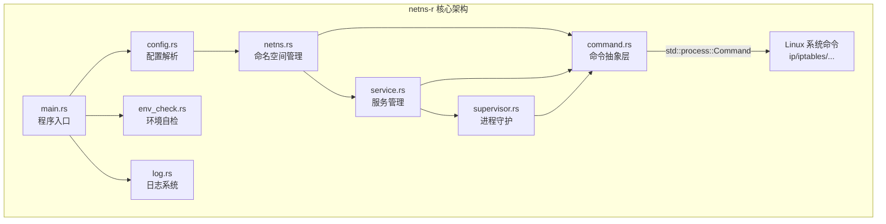

## 产品概述

netns-r 是一个用 Rust 编写的网络命名空间管理工具，用于在 Linux 系统中进行轻量级网络隔离调试网络程序。提供统一的配置文件入口，实现类似 Ansible playbook 的"代码即设施"体验。

## 核心功能

- **环境自检**：启动时打印操作系统、内核版本、CPU 数量、内存大小、虚拟化环境；检查 iproute2 是否安装、netns 是否支持、是否有权限创建 netns、扫描 raw-dev 设备
- **网络命名空间管理**：基于 YAML 配置文件，使用系统原生 `ip` 命令创建/删除/配置网络命名空间；支持两种网络设备模式：
- `use-raw-dev=yes`：直接使用物理网卡
- `use-raw-dev=no`：创建 veth 设备对，主机端配置 NAT 转发（iptables）
- **DNS 配置**：为每个命名空间创建独立的 `/etc/netns/$ns/resolv.conf` 文件
- **服务管理**：在指定命名空间内运行服务命令，支持环境变量、日志文件重定向
- **进程守护器**：当 `global.supervisord.enable=yes` 时，实现内存状态机持续监控服务进程，异常时自动重启；否则以 oneshot 模式一次性运行
- **日志系统**：分 debug/info/error 三级，格式为"时间 [等级] 内容"，命令执行结果用颜色区分（成功绿色、失败红色、未知黄色）
- **命令抽象层**：使用 `std::process::Command` 调用系统命令，设计接口便于未来替换为原生实现
- **编译和部署**：创建 Dockerfile 构建开发镜像（Alpine + Rust + iproute2），提供 Makefile 方便编译安装

## 技术栈选择

- **开发语言**：Rust（最新稳定版）
- **配置解析**：`serde` + `serde_yaml`（YAML 解析）
- **命令行参数**：`clap`（CLI 参数解析）
- **日志**：自实现，使用 `colored` crate 实现终端颜色输出，`chrono` 处理时间戳
- **系统交互**：`std::process::Command` 封装所有 Linux 系统命令（`ip`, `iptables` 等）
- **进程管理**：`std::process` + `nix` crate（用于 Unix 信号处理和进程管理）
- **容器环境**：Alpine Linux（最新版），通过 Dockerfile 构建开发镜像

## 实现方案

### 系统架构



### 模块设计

#### 1. 配置模块 (`config.rs`)

- 解析 `netns.yaml` 配置文件
- 支持变量替换 `$(netns)` 和 `$(service)`
- 配置结构体使用 serde 反序列化

#### 2. 环境自检模块 (`env_check.rs`)

- 检测操作系统类型和内核版本
- 检测 CPU 核心数和内存大小
- 检测虚拟化环境（LXC/Docker/Bare Metal）
- 检查 iproute2 相关命令（ip, iptables）
- 检查 netns 支持和权限
- 扫描可用的物理网络设备

#### 3. 命令抽象层 (`command.rs`)

- 定义 `CommandExecutor` trait，抽象命令执行接口
- 实现 `SystemCommandExecutor`，使用 `std::process::Command`
- 统一处理命令输出、错误和返回码
- 便于未来替换为原生 Rust 实现

```rust
trait CommandExecutor {
    fn execute(&self, cmd: &str, args: &[&str]) -> Result<CommandOutput>;
    fn execute_in_ns(&self, ns: &str, cmd: &str, args: &[&str]) -> Result<CommandOutput>;
}

struct CommandOutput {
    stdout: String,
    stderr: String,
    exit_code: i32,
    status: ExecStatus, // Success | Failed | Unknown
}
```

#### 4. 日志模块 (`log.rs`)

- 三级日志：Debug、Info、Error
- 格式：`时间 [等级] 内容`
- 颜色输出：Success 绿色、Failed 红色、Unknown 黄色
- 支持输出到文件和终端

#### 5. 网络命名空间模块 (`netns.rs`)

- 创建命名空间：`ip netns add $name`
- 删除命名空间：`ip netns delete $name`
- 检查命名空间是否存在
- 配置网络设备：
- **Raw 模式**：`ip link set dev $raw_dev netns $ns`
- **Veth 模式**：

    1. `ip link add $veth_dev type veth peer name $veth_dev-peer`
    2. `ip link set $veth_dev netns $ns`
    3. 配置主机端 NAT（iptables MASQUERADE）

- 配置 IP 地址：`ip addr add $addr dev $dev`
- 配置路由：`ip route add default via $gateway`
- 配置 DNS：创建 `/etc/netns/$ns/resolv.conf`

#### 6. 服务管理模块 (`service.rs`)

- 在命名空间内启动服务：`ip netns exec $ns $command`
- 支持环境变量设置
- 支持日志文件重定向（stdout/stderr）
- 变量替换：`$(netns)`, `$(service)`

#### 7. 进程守护模块 (`supervisor.rs`)

- 内存状态机：跟踪每个服务的运行状态（Running/Stopped/Failed/Restarting）
- 定期检查服务状态（可配置间隔）
- 异常检测：进程退出码非零或进程消失
- 自动重启：指数退避策略
- 状态查询：提供服务状态查询接口

```rust
enum ServiceState {
    Running { pid: u32, start_time: Instant },
    Stopped,
    Failed { last_error: String, retry_count: u32 },
    Restarting { next_retry: Instant },
}

struct ServiceTracker {
    states: HashMap<String, ServiceState>,
    check_interval: Duration,
    max_retries: u32,
}
```

### 目录结构

```
netns-r/
├── Cargo.toml
├── Makefile
├── Dockerfile                    # 开发环境镜像
├── example-netns.yaml            # 示例配置
├── example-netsh.sh              # 参考脚本
├── src/
│   ├── main.rs                   # 程序入口
│   ├── config.rs                 # 配置解析
│   ├── env_check.rs              # 环境自检
│   ├── command.rs                # 命令抽象层
│   ├── netns.rs                  # 命名空间管理
│   ├── service.rs                # 服务管理
│   ├── supervisor.rs             # 进程守护
│   └── log.rs                    # 日志系统
└── tests/
    └── integration.rs            # 集成测试
```

## 实现注意事项

### 性能考虑

- 命令执行为主要性能瓶颈，尽量减少不必要的系统调用
- 进程监控使用定期轮询而非实时监听，避免资源消耗
- 配置文件一次性加载到内存，运行时使用缓存

### 错误处理

- 所有系统命令调用必须检查返回值和 stderr
- 环境自检失败直接退出，给出明确错误提示
- 服务启动失败记录详细日志，支持重试

### 安全性

- 需要 root 权限运行（netns 操作需要 CAP_NET_ADMIN）
- 配置文件中敏感信息（如密钥）需要特殊处理
- iptables 规则需要谨慎管理，避免影响主机网络

### 向后兼容

- 配置文件中 `gatway` 拼写问题需要兼容处理
- 命令抽象层设计为 trait，便于未来替换实现