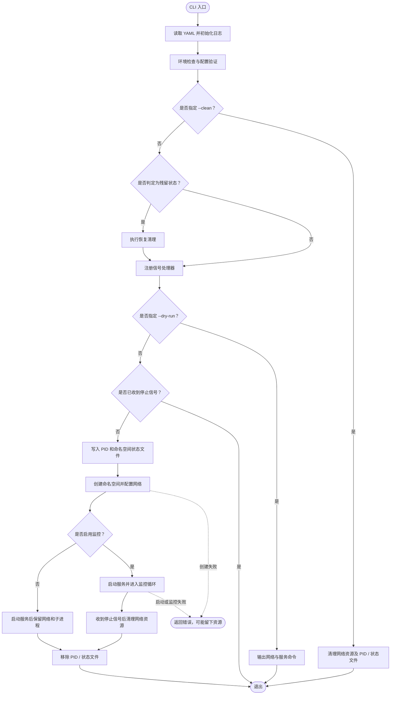
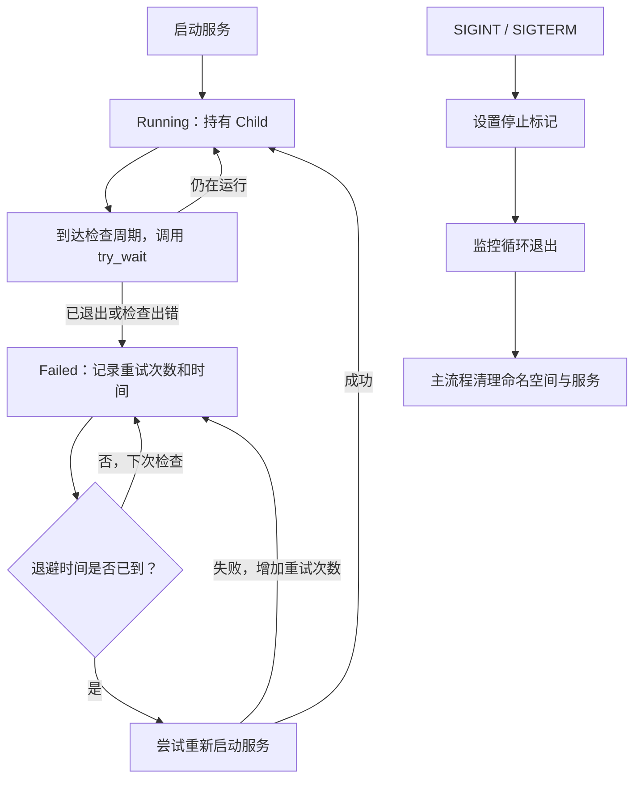

# 设计说明

## 目标与范围

通过一份 YAML 配置创建 Linux 网络命名空间、配置网络并启动服务。当前实现调用系统 `ip`、`iptables`、`ip6tables`、`sysctl` 等工具，没有直接使用 netlink，也没有容器镜像或文件系统隔离能力。

## 项目结构

```text
netns-r/
├── README.md                 # 项目入口
├── Cargo.toml / Cargo.lock   # 包定义和依赖锁定
├── Makefile                  # 构建和检查快捷入口
├── .dockerignore             # 根目录构建上下文的排除规则
├── docker/                   # arm64 / x86_64 构建与运行镜像
├── conf/
│   ├── config.example.simple.yaml  # 最小 veth 示例
│   ├── config.example.full.yaml    # 带注释的完整示例（raw-dev、多命名空间）
│   └── config.yaml           # 本地配置，Git 忽略
├── docs/                     # 使用、设计、测试、历史和待办
├── src/                      # Rust 实现
└── tests/integration.rs      # 基础集成测试
```

## 模块职责

| 模块 | 职责 |
| --- | --- |
| `main.rs` | CLI、启动顺序、信号处理和清理入口 |
| `config.rs` | YAML 解析、基础验证、模板替换和服务列表选择 |
| `env_check.rs` | 系统信息、权限、iproute2 和命名空间能力检查 |
| `command.rs` | 系统命令执行、退出状态及 dry-run 输出 |
| `netns.rs` | 网络空间、设备、地址、路由、NAT 和 DNS |
| `supervisor.rs` | 服务子进程、状态检查和重启 |
| `pidfile.rs` | PID、命名空间状态文件及异常恢复 |
| `log_system.rs` | 终端和追加文件日志 |
| `lib.rs` | 向集成测试暴露公共模块 |

## 当前执行流程




此图描述实际代码，不能理解为事务保证。环境检查和恢复发生在 dry-run 判断之前；网络或服务启动失败时的错误返回也可能绕过正常清理。

## 网络资源

veth 模式为每个命名空间创建一对接口，主机侧命名为 `<veth-dev>-peer`，用配置网关作为主机端地址。指定出口时添加源 CIDR 的 MASQUERADE 规则并开启转发。多个命名空间的地址和网段应自行避免冲突。

raw-dev 模式移动现有设备。清理尝试移回 PID 1 的网络空间，再终止命名空间进程并删除空间。DNS 放在 `/etc/netns/<name>/`。

现有资源没有独立所有权标记。相同名称、相同防火墙规则与其他管理工具之间可能冲突，暂不支持安全的并发管理。

## 服务生命周期

服务以 `namespace/service` 作为状态键。监控模式持有 `Child`，用 `try_wait()` 检测退出，避免仅靠 PID 判断子进程存活。检查周期来自配置，停止标记约每秒检查一次；两者不是同一个周期。

失败服务按重试计数计算指数退避，意图将等待上限设为 60 秒，但当前幂运算仍可能溢出。服务实际重启还受检查周期影响。SIGHUP 暂不触发配置重载。

单次模式只发起子进程，不检查其最终退出状态。命令由 shell 解释，因此配置既是网络声明，也是执行权限边界。

监控循环的服务状态变化如下；每次是否重启仍由配置的检查周期决定。



## 状态与恢复

PID 文件记录主进程 PID，状态文件记录拟创建的命名空间名称。它们不是独占锁，也不记录资源完整配置。正常单次启动退出也会删除这两个文件，即使网络和服务仍然存在。

当前恢复判断会把活跃实例的命名空间误判为残留，因此不支持重复启动。修复方向和其他运行限制见[已知问题](known-issues.md)。
